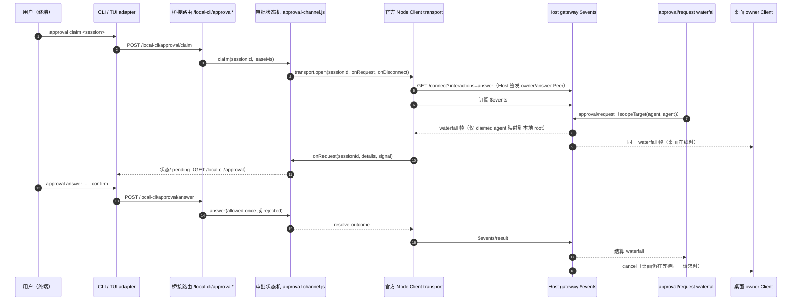
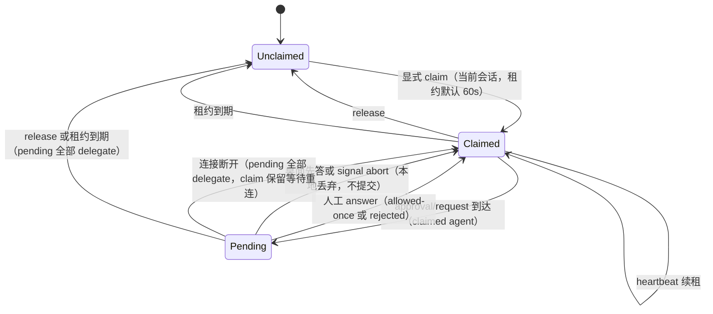
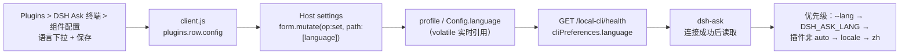

# 架构说明

本文说明 `dsh-ask` 的进程边界、数据流、审批通道和源码位置；安装与使用见根目录 `README.md`。

## 1. 组成部分

| 部分 | 运行位置 | 源码 |
| --- | --- | --- |
| Host 桥接插件 | 已运行的 DeepSeek Harness 桌面版进程内 | `index.js`、`cordis.patch.yml`、`package.json`、`permissions.js` |
| Host 浏览器客户端 | 桌面 web 前端的插件详情页 | `client.js`（`package.json` 的 `./client` 导出） |
| 审批通道（Host 内） | Host 进程内的独立 client Cordis 树 | `approval-channel.js`、`approval-routes.js`、`approval-transport.js` |
| CLI 业务层 | `node dsh-ask.mjs` 进程 | `dsh-ask.mjs`、`dsh-media.mjs`、`dsh-tui.mjs`、`dsh-native-screen.mjs`、`dsh-i18n.mjs`、`dsh-cli-messages.mjs`、`dsh-tui-messages.mjs` |
| 原生显示层 | CLI 拉起的 `dsh-ask-ui` 子进程 | `native/src/` |

CLI 不会启动第二个 Harness profile。桥接插件只注册 loopback HTTP 端点；原生层只负责
终端绘制和输入解码，不访问网络、不读 token、不创建 Session。审批通道的官方 Node Client
运行在 Host 进程内，但使用独立 Cordis 树与宿主主树隔离。

语言层是 CLI 业务层的一部分，不单独占进程：`dsh-i18n.mjs` 负责判定与翻译，
`dsh-cli-messages.mjs`、`dsh-tui-messages.mjs` 是各自的文案表（见 §8）。`locale/en.json`、
`locale/zh.json` 目前只有 Host 插件清单的元信息（`meta.title`/`meta.description`）；插件设置项
（language）的文案内联在 `index.js` 的 `Config` schema i18n 标签和 `client.js` 里，尚未放进
locale 文件；两者都不参与 CLI 运行时文案。

插件详情页的组件配置由 `client.js` 提供：它是 Host 浏览器资源（`package.json` 的
`./client` 导出、`dsh.client` 声明 web），用 Host 的 `window.__ModuleLoader__` 与 React
注册 `plugins.row.config` 插槽（key `@local/dsh-local-cli#local-cli`），页上只有语言下拉与
保存。`Config` schema 只定义字段/校验/设置文案，本身不生成 UI；保存由 Host settings 的
`form.mutate([{op:'set', path:['language'], value}], revision)` 写入 profile。`client.js`
不是 CLI 安装器的模块。

## 2. 启动与请求路径

1. 桌面版启动时加载 `@local/dsh-local-cli`，插件在 Host 的 webServer 上注册
   `/local-cli/*` 路由，并把监听地址写入 `$DSH_HOME/local-cli/endpoint`。
2. 首次请求时插件生成随机 token，写入 `$DSH_HOME/local-cli/token`（0600）。
3. `dsh-ask` 读取 endpoint/token，在 `x-local-cli-token` 请求头里带上 token，调用
   对应路由；不匹配的请求直接拒绝。
4. 一次性问答走 `/local-cli/ask` 或 `/local-cli/stream`；交互模式先通过
   `/local-cli/sessions`、`/transcript` 等读取状态，再在聊天时复用同一套路由。
5. 全屏模式下，`dsh-tui.mjs` 把每个视图整理成 `view`，经 fd3 以逐行 JSON 交给
   `dsh-ask-ui`；原生层把按键、窗口变化和错误经 fd4 回传，Node 业务层继续处理会话、
   草稿、附件和流式消息。

协议 JSON 只走 fd3/fd4，不写到终端的 fd0/fd1。

CLI 连接成功后还会读取 `/local-cli/health` 的 `cliPreferences.language`，用于桌面插件
语言设置（见 §8.1）；`--help` 和连接前错误不查询 health。

TTY 交互启动先打开本地草稿，不创建 Host Session；第一次实际发送才调用
`POST /local-cli/create`（`/new`、Ctrl+N 和会话选择器的新建同样如此），显式非交互
`dsh-ask new` 仍立即创建。会话选择器（picker）已完成并安装；真实 PTY 验证：裸启动进入
草稿、Ctrl+P 默认当前 workspace、可切换到全部会话、退出不新增空会话（当前 workspace
会话数 26→26）。

## 3. 桥接路由

| 路由 | 作用 |
| --- | --- |
| `GET /local-cli/health` | 健康检查、`capabilities.images` 与 `cliPreferences.language`（插件语言偏好） |
| `GET /local-cli/sessions` | Session 列表；可选 `workspace`/`cwd`/`sessionId`/`all` 筛选，响应带 `scope` |
| `GET /local-cli/transcript` | Session 记录 |
| `GET /local-cli/queue` | 排队中的提示 |
| `GET /local-cli/workspaces` | workspace 与会话数 |
| `POST /local-cli/create` | 新建 Session |
| `POST /local-cli/ask` | 一次性提问 |
| `POST /local-cli/stream` | 流式提问 |
| `GET /local-cli/status` | 状态只读投影（模型、上下文、token、统计、权限、运行状态） |
| `GET /local-cli/permissions` | 当前权限 preset、可选 preset 与默认值（白名单） |
| `POST /local-cli/permissions` | 经 Host `/permission` 命令切换当前会话 preset（高危需 `confirmed`） |
| `GET /local-cli/awaiting` | 待应答：pending 种类与 `userQuestions` 投影详情 |
| `POST /local-cli/answer` | 显式答复 `continued` 问题 |
| `GET /local-cli/approval` | 审批通道状态：claim、租约、pending（白名单） |
| `POST /local-cli/approval/claim` | 显式 claim 当前会话的终端审批通道 |
| `POST /local-cli/approval/heartbeat` | 续租当前 claim |
| `POST /local-cli/approval/release` | 释放 claim；未答复请求交回后续 answerer/桌面 |
| `POST /local-cli/approval/answer` | 提交 `allowed-once` / `rejected`（本地提交，待 Host 确认） |

`GET /local-cli/sessions` 的 `workspace` 筛选先取 `workspaceRegistry` 的 `sessionIds` 与
可见非 subagent 列表的交集，再 `slice(limit)`；`cwd` 用 canonical 路径比较；`sessionId`
精确/唯一前缀查找不受 limit 限制，响应 `scope` 标明 `all|workspace|cwd|session`。Host 侧
实现位于 `index.js` 的 `canonicalPath`、`visibleSessionItems`、`rowsFor`、
`workspaceForQuery`、`workspaceOfSession`；adapter 侧位于 `dsh-ask.mjs` 的
`fetchSessionsScoped`、`fetchSessionContext` 与 `createTuiAdapter.listSessionsScoped` /
`fetchSessionContext`。旧 Host 无 `scope` 时 adapter 明确标记 `supported:false` 或抛
`workspace-scope-unsupported`，不假装筛选成功。

`/local-cli/status` 已在真实运行的桌面 Host 上通过 HMR 重载验证。`/local-cli/permissions`、
`/local-cli/awaiting`、`/local-cli/answer` 以及审批通道路由已实现并通过离线/mock 测试；
审批路由与惰性 transport 已由 `index.js` 接线（只有显式 claim 才建立官方 owner/answer
Node Client），并已在真实桌面 Host 完成插件重载：`GET /local-cli/approval` 已上线；在新建
的专用空白会话中真实 claim 成功（`connected:true`、pending 0），release 成功
（delegated 0）后 `claim:null`；验证未对任何真实审批作答。旧 Host 缺少
`/local-cli/approval*` 路由时，相关命令明确报旧 Host/不支持并降级到桌面，聊天不受影响。

## 4. 审批通道（官方 Node Client）

### 4.1 设计要点

- Host 的官方扩展点是 `approval/request` waterfall answerer：answerer 返回
  `allowed-once` / `rejected` / `cancelled` / `unavailable`，或调用 `next()` 委派。
  Agent-scoped listener 只收到该 Agent 的请求；部署组合一个终结 answerer，同级顺序不是
  策略优先级机制。本仓库不修改 Host、不注册 `prepend` 监听器抢占桌面。
- 终端通道通过 Host 的公开 Node Client 路径接入：Host 侧
  `connection.authenticatedUrl(origin)` + `GET /connect?token=…&interactions=answer`
  取得 Host 自己签发的 owner/answer Peer 与内存 Cookie，再用官方
  `dsh-client-connection` / `dsh-typert-registry` / `dsh-api-gateway` 客户端包建立独立
  client Cordis 树，订阅 `$events` 的 `approval/request`，通过 `$events/result` 作答。
- 过滤只按 claimed session：client 侧 `agent` Context 适配器只把
  `agentId === claimedSessionId` 映射到本地 root，其他会话由官方 gateway 直接回 `next`，
  不登记、不缓存、不暴露；listener 内再以 `request.agent` 同一性防御。
- claim 默认租约 60s，由调用方（CLI 单次命令或 TUI adapter）心跳续租；release、租约到期、
  连接断开或请求 signal 取消时，未答复请求一律交回后续 answerer/桌面（fail closed），
  不会被自动允许或拒绝。
- 桌面与终端非排他：同一 pending 会投递给所有 owner/answer Client；先给出显式人工答复
  的一方生效，另一方收到 cancel。终端无法阻止桌面同时展示同一请求。
- 答复路由返回 `final:false`：只表示本地状态机接受了提交，等待 Host 确认；不声称 Host
  已允许或已写入 `approval/decided`。token、认证 URL、Cookie 只在 Host 进程内存中。

### 4.2 端到端时序

> 以下 Mermaid 图未在本机实际渲染：当前机器没有可用的 Mermaid CLI（`mmdc`/`mermaid`），
> 仅按 Mermaid 语法人工核对。请在支持 Mermaid 的查看器中预览确认，不把“未渲染”当作
> 已验证的渲染结果。

### 4.3 生命周期

### 4.4 源码位置与当前状态

- `approval-channel.js`：claim/lease/heartbeat/release、pending 登记、单次结算、dispose；
  纯状态机，不建立连接。
- `approval-routes.js`：上述五条 `/local-cli/approval*` 路由的鉴权、严格 body、错误映射。
- `approval-transport.js`：官方 Node Client transport；从 Host runtime 解析官方包，内存
  Cookie，只映射 claimed session；失败返回 `transport-unavailable`。
- `dsh-ask.mjs`：`approval status|claim|release|answer` 子命令与 TUI adapter 五个固定方法
  （claim 成功后自动心跳，release 停止心跳）。
- `dsh-tui.mjs`：全屏 `/approvals`（F2）的显式 claim/release、pending 详情、二次确认和
  “已提交待 Host 确认”文案。
- `index.js`：已接线审批路由与惰性 channel/transport 实例（显式 claim 前不建立连接），并在 `/local-cli/health` 的 `capabilities.approvalChannel` 标记能力；已在真实桌面 Host 完成插件重载并验证（见 §7）。
- `client.js`：Host 浏览器资源（`package.json` 的 `./client` 导出、`dsh.client` 声明 web）；用 `window.__ModuleLoader__` + React 注册 `plugins.row.config` 插槽（key `@local/dsh-local-cli#local-cli`），只提供语言下拉与保存，保存调用 `form.mutate([{op:'set', path:['language'], value}], revision)`。不是 CLI 安装器模块。
- 上游契约：`@deepseek-ai/dsh-user-approval`（`approval/request`）、
  `@deepseek-ai/dsh-api-gateway`（`$events` / `$events/result`）、
  `@deepseek-ai/dsh-client-connection`（`/connect` owner/answer Peer）。

## 5. 状态与图片边界

- 状态端点只读取白名单投影（`modelSelection`、`contextPressure`、`tokenUsage`、
  `permissions`）和被动运行状态；原始投影、Session header、provider 配置和凭据不会
  返回。字符串会净化并截断。
- 权限/待应答端点只读取 `permissionPresets.catalog()`、`permissions`/`userQuestions`
  投影与被动运行状态；标识与标签逐字节 round-trip，无法安全往返的输入显式
  `schema-invalid`，不做静默净化。
- 工具审批走独立审批通道路由；`open` 问题仍没有 Host 答复 API，只能到桌面端处理；
  只有 `state:"continued"` 的问题可经 `userQuestions/answer` 回答。终端审批的 pending 与
  答复来自本仓库状态机和官方 Node Client，不返回 token、Cookie、认证 URL 或连接句柄。
- 图片附件由 CLI 读取、校验并作为 content parts 交给 Host；桥接只转发，不解释图片。
  CLI 的 4 张 / 5 MiB / 12 MiB 上限是本地限制，Host 可能更严格。
- 图片通道可用不代表所选模型支持视觉输入。当前桌面默认 DeepSeek 模型会以
  `image-model-unsupported`（HTTP 422）拒绝带图请求。
- 中断只停止本地等待，不向 Host 发送取消；CLI 不会声称远端 Session 已取消。

## 6. 源码位置

- `index.js`：Host 服务注入、路由、token、投影读取和净化；Session 列表的
  `canonicalPath`/`visibleSessionItems`/`rowsFor`/`workspaceForQuery`/`workspaceOfSession`
  与 `/local-cli/sessions` 的 scope 查询；已接线审批路由与惰性 transport（见 §4.4）。
- `permissions.js`：权限 preset 与 `continued` 问题应答路由。
- `approval-channel.js` / `approval-routes.js` / `approval-transport.js`：审批状态机、
  HTTP 路由与官方 Node Client transport（契约见 `docs/permissions.md`）。
- `dsh-ask.mjs`：参数解析、Host 连接、一次性问答、逐行模式、状态命令、权限/待应答命令、
  `approval` 子命令与 TUI adapter；workspace 会话 adapter 为 `fetchSessionsScoped`、
  `fetchSessionContext` 与 `createTuiAdapter.listSessionsScoped` / `fetchSessionContext`。
- `dsh-media.mjs`：图片格式/大小校验、剪贴板读取、iTerm2/kitty 预览。
- `dsh-tui.mjs`：全屏会话状态、命令、按键、流式消息、`view.statusLines`、`/approvals`
  审批界面与懒创建草稿（`startDraftSession`、`createSessionForSend`）；`/resume` 的
  workspace 默认筛选与全部切换已在真实 PTY 验证（见 §7）。
- `dsh-native-screen.mjs`：spawn `dsh-ask-ui`，fd3/fd4 编解码和进程生命周期。
- `dsh-i18n.mjs`：`resolveLanguage`（`--lang`/`DSH_ASK_LANG`/locale/默认 zh 的判定）、
  `createTranslator`（单趟插值、缺键可诊断）、`nativeUiLabels`（`view.ui` 的七个字段）；
  桌面插件语言由 CLI 连接成功后经 health 读取（见 §8.1）。
- `dsh-cli-messages.mjs`：CLI 与逐行界面的 `{key:{en,zh}}` 文案表，由 `createTranslator`
  消费；只含本工具文字，不含 Host 数据。
- `dsh-tui-messages.mjs`：全屏界面的文案表（提示行、命令/快捷键、状态词、启动/草稿/发送/
  附件提示），同样是纯数据。
- `locale/en.json`、`locale/zh.json`：目前只有 Host 插件清单的 `meta.title`/`meta.description`；
  插件设置项文案在 `index.js` 的 `Config` schema 内联 i18n 标签里，不在 locale 文件；两者都
  不是 CLI 运行时 catalog（见 §8.3）。
- `native/src/render/`：Ratatui 布局和绘制；`native/src/input.rs` 负责按键/粘贴解码；
  `native/src/ipc.rs` 负责 JSON 行读写。
- `native/tests/` 和 `tests/`：离屏布局、协议、假 Host 与 mock 审批通道测试。

## 7. 验证边界

- 审批通道已完成真实桌面 Host 的插件重载验证：审批端点上线；在新建专用空白会话中真实
  claim 成功（`connected:true`、pending 0），release 成功（delegated 0）后 `claim:null`。
  验证未对任何真实审批作答。
- 测试范围：Node 侧用假 Host 覆盖 CLI/逐行/全屏业务层与桥接协议；Rust 侧用 TestBackend
  覆盖布局、按键/粘贴解码、fd3/fd4 协议与状态行。运行命令见 README。两者都不读写真实
  会话或凭据。
- 会话选择器（picker）已完成并安装；真实 PTY 验证裸启动进入草稿、Ctrl+P 默认当前
  workspace、可切换到全部会话、退出不新增空会话（当前 workspace 会话数 26→26）。

## 8. 语言与文案边界（i18n）

### 8.1 判定顺序

语言在命令启动阶段确定一次（连接 Host 后还会按插件偏好再判定一次），之后整个命令生命
周期内不变。桌面插件设置只在 CLI 成功连上 Host 后参与判定；`--help` 和连接前的错误走
离线路径。顺序为：

1. `--lang zh|en`（也接受 `--lang=zh`）。所有子命令和交互入口都接受，放在子命令前后均可；
   非法值是用法错误，退出码 2（`error.code === 'invalid-language'` 被转换为 `UsageError`）。
2. 有效的 `DSH_ASK_LANG=zh|en`；非法值只告警一次并忽略，不中断会话。
3. 桌面插件设置的非 `auto` 语言：Plugins > DSH Ask 终端 > 组件配置 里的 language 下拉
   （`auto|zh|en`，由 `client.js` 注册的 `plugins.row.config` 插槽提供；`Config` schema 本身
   不生成 UI）。保存调用 `form.mutate([{op:'set', path:['language'], value}], revision)` 经
   Host settings 写入 profile，保存可持久；`Config.language` 以 volatile（实时配置引用）形式
   交给插件读取，volatile 不代表不持久化。插件通过 `GET /local-cli/health` 的
   `cliPreferences.language` 返回当前偏好（默认 `auto`，`auto` 表示不指定），CLI 连接成功后
   读取；`auto` 继续下一步。
4. 系统 locale，按 POSIX 顺序 `LC_ALL` > `LC_MESSAGES` > `LANG`：`zh*` → 中文，
   `en*` → 英文（忽略区域与编码后缀）。
5. 其余情况（`C`、`POSIX`、`C.UTF-8`、未知语言、全部未设置）→ 默认 `zh`。

`--help`、参数解析错误和连接前错误是离线判定：只使用 `--lang` / `DSH_ASK_LANG` / locale，
不会为了渲染帮助或错误信息连接或启动 Host。

判定由 `dsh-i18n.mjs` 的 `resolveLanguage({ lang, pluginLanguage, env, warn })` 实现；CLI 在
`parseCli()` 先用参数 / 环境 / locale 判定，`connectToHost()` 成功后用 health 的
`cliPreferences.language` 再解析一次（`adoptHostLanguage()`）并写回 `options.lang`。
`--help` 与连接前错误不会做 health 探测。语言值仍通过 `runTui` 的 `options.lang` 交给
全屏业务层。运行中的全屏/逐行会话没有
即时切换入口：桌面改插件设置或换 `--lang` / 环境变量后，重启 CLI 命令才生效。

### 8.2 翻译边界

| 内容 | 处理 |
| --- | --- |
| 本工具自身文案：帮助、子命令输出、逐行/全屏提示、本地错误、状态行标签 | 翻译（中/英） |
| 聊天内容（user/assistant/tool 文本）、Host 返回的 `error` 文本 | 原样透传，不翻译 |
| 会话标题、cwd/路径、Session/claim/request 等 id、模型名、问题与审批标签 | 原样透传，不翻译 |
| JSON 的键与值、`code` 等错误码 | 不翻译；`--json` 输出与语言无关，逐字节相同 |
| 模型回答的语言 | 不受影响：`--lang` 只切本工具界面文字，不是给模型的回答语言指令 |

### 8.3 三层文案与 `view.ui` 契约

- CLI catalog：`dsh-cli-messages.mjs`，形态 `{ key: { en, zh } }`，键是英文模板，经
  `createTranslator(lang, catalog)` 消费。插值单趟完成，参数值原样插入、不会被二次扫描；
  缺键或缺当前语言时渲染为 `⟦key⟧`，便于发现漏翻。
- TUI catalog：`dsh-tui-messages.mjs`，同样由 `createTranslator` 消费，只含本工具文字
  （提示行、命令/快捷键、状态词、启动/草稿/发送/附件提示），不含 Host 数据。
- 原生层（Rust）不读 `--lang`、环境变量或 locale，也不内置语言判定：它只绘制 JS 每帧传来
  的 `view.ui`，字段为 `placeholder`、`emptyList`、`searchPlaceholder`、`hintFallback`、
  `backToBottom`（4 档，从宽到窄）、`modalTitleHelp`、`modalTitleSessions`（camelCase，
  latest-wins）。
- `ui` 在 wire 上是可选的：缺失或 `null` 时使用 native 侧内置默认值（即 i18n 之前 native
  硬编码的原文，多数为英文；两个弹窗默认标题原为中文），因此“新 binary + 旧 view”的渲染
  结果与改造前一致；未知字段被忽略，向后兼容。
- CLI 只向 TUI 传一个语言值（`runTui` 的 `options.lang`）；TUI 不自行解析 `--lang`，但仍用
  同一个 `resolveLanguage` 为直接调用兜底。
- `locale/en.json`、`locale/zh.json` 目前只有 Host 插件清单的 `meta.title`/`meta.description`
  （由 `package.json` 的 `exports`/`files` 暴露）；插件设置项（language）的展示文案目前内联在
  `index.js` 的 `Config` schema i18n 标签和 `client.js` 里，尚未放进这两个文件；它们不是 CLI
  运行时 catalog，与 `dsh-cli-messages.mjs` / `dsh-tui-messages.mjs` 相互独立，不要把运行时
  key 写进这两个文件。

### 8.4 安装闭包

`scripts/install.sh` 的 `MODULES` 现在是 7 个 JS 模块：`dsh-ask.mjs`、`dsh-media.mjs`、
`dsh-tui.mjs`、`dsh-native-screen.mjs`、`dsh-i18n.mjs`、`dsh-cli-messages.mjs`、
`dsh-tui-messages.mjs`。安装前会校验它们的相对 import 闭包：`dsh-ask.mjs` 静态引用 i18n
核心与 CLI 文案表，`dsh-tui.mjs` 引用 TUI 文案表；漏掉任一模块会在写入安装根之前失败。
`dsh-tui-screen.mjs`（旧的纯 Node 屏幕层）仍不安装。`client.js` 是桌面端 Host 浏览器资源，
随插件包 `./client` 导出，不属于这个 CLI 安装器的 7 个 JS 模块，也不会被复制到
`$DSH_CLI_INSTALL_ROOT`。
